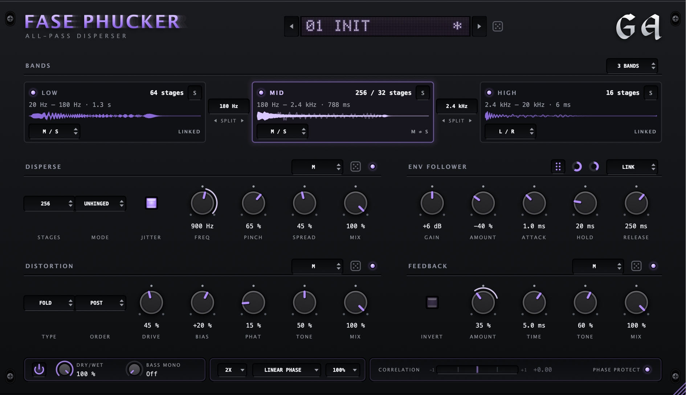

# Fase Phucker



**ALL-PASS DISPERSER** – a free multiband all-pass disperser by GA: up to 1000 all-pass stages per
band, with distortion, feedback and an envelope follower for weird, transient-smearing sound design.
It's inspired by a thousand Ableton EQ3's phuckery

Split the signal into one, two or three bands, and give each its own chain, in L / R or M / S:
**Disperse** smears it through up to 1000 all-pass stages (Behaved, or Unhinged and glitchy when
you move it), **Distortion** sits before or after that (Noise, Saturate, Clip, Fold, Rectify,
Crush), **Feedback** loops around the all-pass chain and self-oscillates past about 80 %, and the
**Env Follower** drives any of their knobs: drag its grip onto one. Every band card shows the band's
real impulse response.

The second plug-in in the GA family after
[Hyper! Hyper! Dimension](https://github.com/georgeabyss/GA-hyper-hyper-dimension), with the same
bottom row: loudness-matched output, equal-loudness bypass, Dry/Wet and Bass Mono with locks,
oversampling (only Distortion is oversampled), Phase Protect and a resizable window.

Interface and sound designed and tested by GA, coded with the help of AI.

**[Get it on the releases page](https://github.com/georgeabyss/GA-fase-phucker/releases)**:
Mac (VST3 and AU) and Windows (VST3).

**Tips:** drag knobs up and down (hold Shift for fine moves), double-click to reset, right-click to
type a value or reach your DAW's automation. Each section's drop-down links its two channels or edits
one alone. The dice randomise a section, the one next to the presets everything.

---

## Installing

Grab the zip for your system from the [releases page](https://github.com/georgeabyss/GA-fase-phucker/releases).

**macOS 11 or newer** (`…-macOS.zip`): unzip it and follow **READ ME FIRST.txt**. macOS asks you to
allow the installer once, because it isn't signed with a paid Apple certificate. Then choose VST3
and/or Audio Unit. In Logic you'll find it under Audio Units → GA.

**Windows 10 or 11** (`…-Windows-VST3.zip`): unzip it and copy `Fase Phucker.vst3` to
`C:\Program Files\Common Files\VST3`, then rescan your plug-ins.

To uninstall, delete the plug-in files again (on the Mac from `/Library/Audio/Plug-Ins/VST3` and
`/Library/Audio/Plug-Ins/Components`). See what's new in each version in the [changelog](CHANGELOG.md).

---

## For developers

The design, features, decisions and build steps are in [docs/design/spec.md](docs/design/spec.md).
The second GA plug-in on the shared [GA framework](https://github.com/georgeabyss/ga-framework).

### Build

Built with [JUCE](https://juce.com) and CMake on the GA framework, a git submodule in `framework/`.
JUCE is pinned (the version in `framework/cmake/juce-version.txt`) and found next to this repo:

```sh
git clone --recurse-submodules https://github.com/georgeabyss/GA-fase-phucker.git FasePhucker
git clone --depth 1 --branch "$(cat FasePhucker/framework/cmake/juce-version.txt)" https://github.com/juce-framework/JUCE.git JUCE
cd FasePhucker
cmake -B build -G Ninja -DCMAKE_BUILD_TYPE=Release
cmake --build build
```

The plug-ins end up in `build/FasePhucker_artefacts/Release/` (`VST3/Fase Phucker.vst3`,
`AU/Fase Phucker.component`). There is no copy after the build; to install for your user only (or build the installer with
`./make_installer.sh`: `dist/FasePhucker-<version>-macOS.zip`):

```sh
cp -R "build/FasePhucker_artefacts/Release/VST3/Fase Phucker.vst3" ~/Library/Audio/Plug-Ins/VST3/
cp -R "build/FasePhucker_artefacts/Release/AU/Fase Phucker.component" ~/Library/Audio/Plug-Ins/Components/
```

| | |
| --- | --- |
| Plug-in code / manufacturer | `Fph1` / `Gaau` (GA) |
| Bundle ID | `com.ga.fasephucker` |
| Presets | `~/Music/GA/Fase Phucker/Presets`, `.fphpreset` |

The GA control gallery (every framework control, `framework/docs/controls`): `-DGA_GALLERY=ON`, target `FasePhuckerGallery`.

Screenshots of the real interface: `cmake -B build-tools -G Ninja -DCMAKE_BUILD_TYPE=Release -DFPH_SCREENSHOTS=ON`,
`cmake --build build-tools --target FasePhuckerScreenshots`, then `build-tools/FasePhuckerScreenshots <folder>`.

Parameter IDs never change once they exist: `tools/check_parameters.sh` compares every parameter with
`tests/reference/parameters.txt` and runs the parameter tests (names, channel links, sessions).

The DSP: `tools/check_dsp.sh` measures the engine (flatness, group delay, latency, aliasing, the
feedback loop, the envelope, clicks on every switch, CPU) and compares renders through the plug-in
with `tests/reference/renders`; `tools/check_dsp.sh listen <folder>` writes longer renders to listen to.
